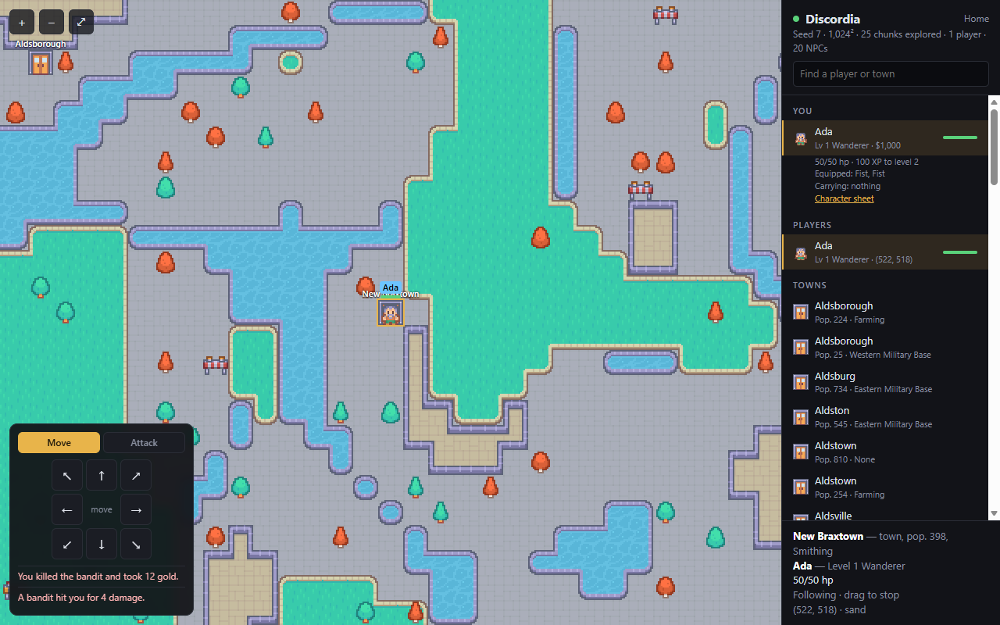
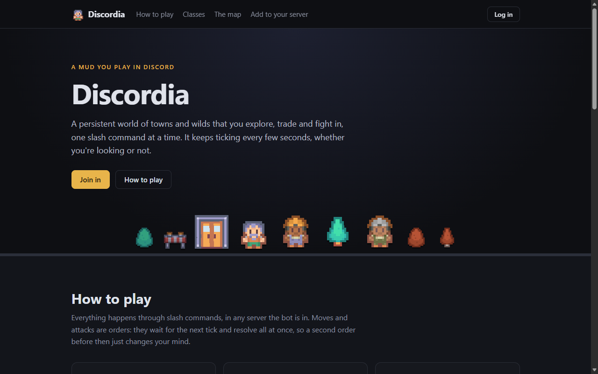
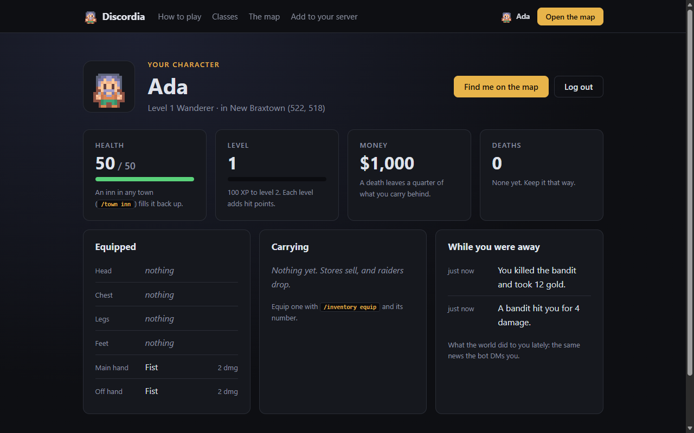

# Discordia
## The highly-anticipated* re-release of DiscordMUD

[](https://github.com/samclane/Discordia/actions/workflows/tests.yml)
[](https://codecov.io/gh/samclane/Discordia)



| Home page | Character sheet |
|---|---|
|  |  |

Requires Python 3.12.

# Starting 

To install:

`pip install -r requirements.txt`

`python main.py [-W PORT] [--database PATH]`

Set the `DISCORD_TOKEN` environment variable, or fill in `Token` under `[Discord]` in `config.ini`.

* `-W PORT` also serves the website on that port: the public home page at `/`, the live map at `/map` and each
  player's character sheet at `/me` (both need a `/weblogin` link), and server settings for `/settings`.
* `--database PATH` is the save file (default `./discordia.db`). The world is saved on a timer and on shutdown,
  and a restart pays hideouts for the time it was down.

Tests: `python -m pytest Discordia/test -q`, no Discord token needed.

# Deploying (Linode / any Ubuntu 24.04 box)

A Nanode (1 GB) is plenty. As root:

```
apt update && apt install -y git python3-venv python3-dev build-essential
useradd --system --home /opt/discordia discordia
git clone https://github.com/samclane/Discordia.git /opt/discordia
python3 -m venv /opt/discordia/venv
/opt/discordia/venv/bin/pip install -r /opt/discordia/requirements.txt
chown -R discordia: /opt/discordia
echo "DISCORD_TOKEN=your-token" > /etc/discordia.env && chmod 600 /etc/discordia.env
cp /opt/discordia/deploy/discordia.service /etc/systemd/system/
systemctl enable --now discordia
journalctl -u discordia -f
```

The save is `/opt/discordia/discordia.db`; copy it over first to keep an existing world. The live map binds to
localhost only, so view it through a tunnel: `ssh -L 8080:localhost:8080 root@<linode-ip>`, then open
http://localhost:8080.

To put the map on the internet: an nginx `server` block for your domain with `proxy_pass http://127.0.0.1:8080;`,
`certbot --nginx -d <domain>` for HTTPS (the login cookie is HTTPS-only), and `PublicUrl = https://<domain>` under
`[Web]` in `/opt/discordia/config.ini`. The home page at `/` is public; the map at `/map` lets in only players with a
`/weblogin` session, so the proxy needs no password of its own. To update, push to master and run `deploy/deploy.sh root@<linode-ip>` from your machine (or
add a `discordia` host to `~/.ssh/config` and run it bare). It refuses if HEAD isn't pushed, pulls, restarts, and
fails if the service doesn't come back up.

Alerts: make a webhook on a private channel (Channel settings > Integrations > Webhooks), then
`echo "DISCORD_WEBHOOK_URL=<webhook-url>" >> /etc/discordia.env` and restart. Warnings, errors and crashes get
posted there; the same text repeats at most once every 10 minutes.

# Player Controls

All player controls are Discord slash commands. Global commands can take up to an hour to appear the first time
the bot syncs them.

* `/register` [`name`]
    * Create a new player character and spawn into the game world.
* `/help`
    * Every command and what it does, privately.
* `/look`
    * Where you are, how dangerous it is and the nearest way out (a town or an extraction point), who's in sight (raiders, animals, players, and the things
      a death left lying about: how many squares away and which way), and a picture of your surroundings, as far as your `FOV` can see.
* `/weblogin`
    * Get a private, one-time link (10 minutes) that logs you in to the website. The map then follows your
      character, with a pad to move, attack and answer encounters from the browser (keys 1-9 like a numpad, T to
      switch), and `/me` is your character sheet with what the world did to you lately. No password: Discord already
      knows who you are.
* `/settings`
    * Server admins (Manage Server): a private link to this server's settings page, to pick the channels the game
      plays in, where the daily digest goes, and where players' deaths and hauls are announced. Needs `-W`.
* `/equipment`
    * Prints your "character sheet" in chat: name, level and experience to the next one, money, health, and equipment.
* `/move` [`direction`]
    * Directions are (`north`, `east`, `south`, `west`) or (`up`, `down`, `left`, `right`)
    * Move your player character one space in the direction picked from the dropdown.
* `/inventory list`
    * Displays a list of the items in the players inventory
    * `/inventory equip` [`index`]
        * Have your PC equip the item from your inventory with the specified index. 
    * `/inventory unequip` [`index`]
        * Remove the item from your equipment and put it back into your inventory.
    * `/inventory pouch` [`index`]
        * Move that item into your secure pouch (one slot, anywhere), which a death leaves on you. Whatever
          was in it goes back to the backpack; no index just empties it.
* `/attack` <`direction`>
    * Directions are (`north`, `east`, `south`, `west`) or (`up`, `down`, `left`, `right`), or valid in-betweens (e.x. `ne` for northeast, etc.)
    * Attack another player or an NPC with your currently equipped weapon. If no `direction` is specified, the user
    will attack in the current position only. Otherwise, ranged weapons go in a single direction like a "beam", until
    they either a) hit someone and apply damage, or b) Miss, as the damage falloff, as each tile the projectile
    traverses removes % damage until it goes to 0.
    * Killing an NPC hands you its money and whatever it was carrying.
    * You hear about what happens while you're not looking by DM: a raider spotting you, the first hit of a
      fight and how it ends (not every blow), and how an auto-raid went. `/me` on the website keeps the full log.
* `/choose` [`talk`|`rob`|`ignore`]
    * Wandering the wilds can turn up a stranger on the road, who waits for you to decide what to do.
    * `talk` gets you directions to the nearest town, `rob` is a contest of your level against theirs
    (win and you take their money, lose and they hurt you), `ignore` walks on. Moving anywhere also
    counts as walking on.
* `/trade list`
    * The wilds can also turn up a trader with a few things laid out on a blanket. Lists what they have
    and what they want for it, at a markup over town prices.
    * `/trade buy` [`index`]
        * Buy the trader's item at that index (start typing its name to pick it). They are gone as soon as you
          move on.
* `/town status`
    * Which town you're in, its population, and who runs the place: the shopkeeper, innkeeper and guard.
    * `/town inn`
        * Rest at the inn: back to full health, free.
    * `/town recruit`
        * Change your player class to the one the town trains (`/town status` says which). Military bases train
          Soldiers (75 HP). Mining towns train Scavengers (a cache gives one more salvage), farming towns Medics
          (camping heals twice as fast), woodworking towns Scouts (see a square further), smithing towns Fixers
          (stores pay a quarter more when you sell).
    * `/town store list` [`kind`]
        * What the town's store sells, grouped into weapons, armor, ammo and other, cheapest first, with each
          item's damage, armor or rounds. ✗ marks what you can't afford. `kind` shows just one group.
        * `/town store buy` [`index`]
            * Purchase the item at the given index, adding it to your inventory. Start typing an item's name
              and Discord suggests matches with their prices, so you don't need the list's numbers.
        * `/town store sell` [`index`]
            * Sell the inventory item at that index for what it's worth (a part-used ammo box for what's left in it).
* `/stash list`
    * In any town: what you've banked. The stash is one per player, reachable from every town, and
    dying out in the wilds never touches it. Dying anywhere but a town loses everything you were
    carrying, money and worn gear included, so bank what you want to keep before heading out.
    * `/stash put` [`item`] [`money`]
        * Bank the inventory item at that index and/or that much money.
    * `/stash take` [`item`] [`money`]
        * Take the stashed item at that index and/or that much money back to carry.
* `/raid` [`minutes`] [`depth`]
    * From any town: send your character out alone, no deeper than danger `depth` (default 1: safe, small hauls;
      deeper pays more and kills more). It walks to the nearest stocked cache in reach, fights whatever it meets, and heads for the nearest town when time is up or it's badly hurt. You get one message at the end:
      what it brought home, or what it lost.
* `/camp`
    * Out past the towns: rest where you stand, healing a little every minute (full in about twenty) until you
      move. Raiders can still find you.
* `/hideout build`
    * In any town: buy the next level of your hideout, from what you carry then the stash. The first costs $1000
      and each after 15% more; every 5th costs salvage instead, which only caches out in the wilds hold. Each level
      pays money into your stash every few minutes, whether you're playing or not.
            
# Attributions

Sprites - [Kenney RPG Urban Pack](https://kenney.nl/assets/rpg-urban-pack)
